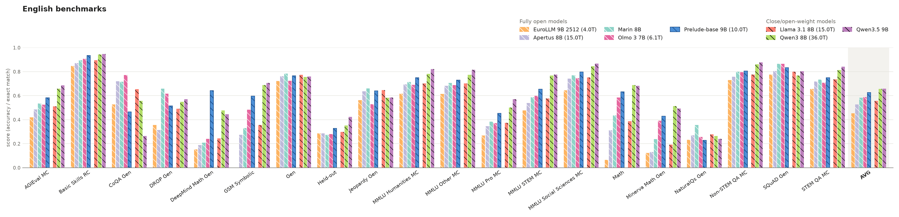
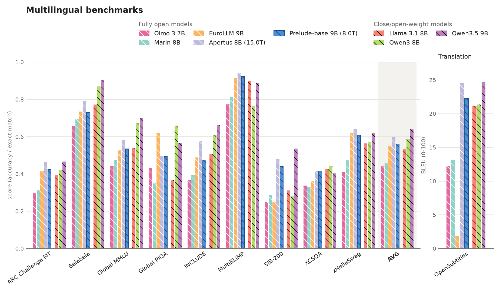
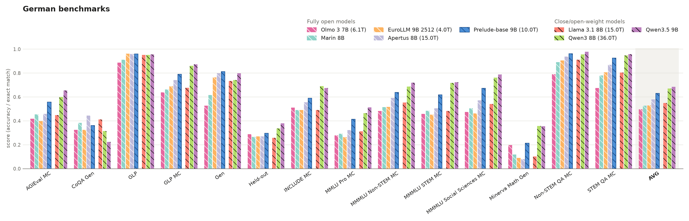
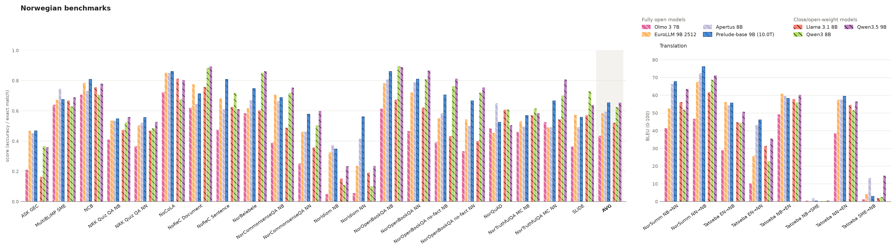

# Prelude evaluations

Compares OpenEuroLLM Prelude 9B with fully open models (open weights and
training data) and open-weight models of similar size on English,
Multilingual, German and Norwegian benchmarks; run it with
`uv run plot_results.py`. The script downloads the scores from the HF datasets
`openeurollm/prelude-base-eval-scores` and `ellamind/eval-scores-ref`, takes
each model's released model (else its latest checkpoint), keeps only the tasks
every model of a category has, and averages tasks within each benchmark group
and then over groups (AVG, which excludes BLEU/chrF translation scores). It
writes one bar plot per category to `figures/` and regenerates the Results
section below, where the best value of each column is bold and, in the plots,
fully open models (white diagonal hatching, Prelude last, outlined) are
followed by open-weight models (black diagonal hatching).

# Results

Automatically generated by `plot_results.py` on 2026-11-09; do not edit below this line.

## English

| model | AGIEval MC | Basic Skills RC | CoQA Gen | DROP Gen | DeepMind Math Gen | GSM Symbolic | Gen | Held-out | Jeopardy Gen | MMLU Humanities MC | MMLU Other MC | MMLU Pro MC | MMLU STEM MC | MMLU Social Sciences MC | Math | Minerva Math Gen | NaturalQs Gen | Non-STEM QA MC | SQuAD Gen | STEM QA MC | AVG |
|---|---:|---:|---:|---:|---:|---:|---:|---:|---:|---:|---:|---:|---:|---:|---:|---:|---:|---:|---:|---:|---:|
| ***Fully open models*** | | | | | | | | | | | | | | | | | | | | | |
| EuroLLM 9B 2512 (4.0T) | 0.42 | 0.85 | 0.53 | 0.36 | 0.15 | 0.00 | 0.72 | 0.29 | 0.56 | 0.62 | 0.61 | 0.27 | 0.48 | 0.64 | 0.07 | 0.12 | 0.23 | 0.73 | 0.78 | 0.66 | 0.45 |
| Apertus 8B (15.0T) | 0.48 | 0.87 | 0.72 | 0.31 | 0.19 | 0.27 | 0.76 | 0.29 | 0.64 | 0.69 | 0.68 | 0.35 | 0.54 | 0.74 | 0.31 | 0.13 | 0.27 | 0.76 | 0.81 | 0.72 | 0.53 |
| Marin 8B | 0.54 | 0.90 | 0.72 | **0.66** | 0.21 | 0.33 | **0.78** | 0.27 | **0.66** | 0.71 | 0.71 | 0.38 | 0.59 | 0.77 | 0.44 | 0.24 | **0.36** | 0.80 | 0.86 | 0.73 | 0.58 |
| Olmo 3 7B (6.1T) | 0.53 | 0.91 | **0.77** | 0.62 | 0.24 | 0.48 | 0.72 | 0.28 | 0.53 | 0.69 | 0.69 | 0.37 | 0.60 | 0.75 | 0.58 | 0.39 | 0.26 | 0.80 | **0.87** | 0.71 | 0.59 |
| Prelude-base 9B (10.0T) | 0.58 | 0.94 | 0.47 | 0.52 | **0.64** | 0.60 | 0.77 | 0.33 | 0.64 | 0.75 | 0.73 | 0.45 | 0.66 | 0.80 | 0.63 | 0.43 | 0.23 | 0.81 | 0.83 | 0.75 | 0.63 |
| ***Close/open-weight models*** | | | | | | | | | | | | | | | | | | | | | |
| Llama 3.1 8B (15.0T) | 0.51 | 0.89 | 0.66 | 0.49 | 0.24 | 0.36 | 0.77 | 0.30 | 0.65 | 0.70 | 0.70 | 0.37 | 0.58 | 0.75 | 0.39 | 0.19 | 0.28 | 0.78 | 0.80 | 0.74 | 0.56 |
| Qwen3 8B (36.0T) | 0.66 | 0.94 | 0.56 | 0.55 | 0.48 | 0.69 | 0.76 | 0.35 | 0.58 | 0.78 | 0.77 | 0.50 | 0.77 | 0.85 | **0.69** | **0.51** | 0.26 | 0.86 | 0.77 | 0.81 | **0.66** |
| Qwen3.5 9B | **0.69** | **0.95** | 0.27 | 0.57 | 0.45 | **0.71** | 0.76 | **0.42** | 0.58 | **0.82** | **0.82** | **0.57** | **0.78** | **0.87** | 0.68 | 0.49 | 0.24 | **0.88** | 0.80 | **0.84** | **0.66** |

## Multilingual

| model | ARC Challenge MT | Belebele | Global MMLU | Global PIQA | INCLUDE | MultiBLiMP | SIB-200 | XCSQA | xHellaSwag | OpenSubtitles | AVG |
|---|---:|---:|---:|---:|---:|---:|---:|---:|---:|---:|---:|
| ***Fully open models*** | | | | | | | | | | | |
| Olmo 3 7B | 0.30 | 0.66 | 0.44 | 0.43 | 0.37 | 0.78 | 0.25 | 0.34 | 0.41 | 12.3 | 0.44 |
| Marin 8B | 0.31 | 0.69 | 0.48 | 0.35 | 0.39 | 0.82 | 0.29 | 0.33 | 0.47 | 13.2 | 0.46 |
| EuroLLM 9B | 0.41 | 0.74 | 0.53 | 0.62 | 0.49 | 0.92 | 0.25 | 0.36 | 0.62 | 1.9 | 0.55 |
| Apertus 8B (15.0T) | 0.46 | 0.79 | 0.58 | 0.49 | 0.58 | **0.94** | 0.48 | 0.42 | **0.64** | 24.6 | 0.60 |
| Prelude-base 9B (8.0T) | 0.42 | 0.73 | 0.53 | 0.49 | 0.48 | 0.92 | 0.44 | 0.42 | 0.61 | 22.2 | 0.56 |
| ***Close/open-weight models*** | | | | | | | | | | | |
| Llama 3.1 8B | 0.39 | 0.77 | 0.54 | 0.37 | 0.51 | 0.90 | 0.31 | 0.43 | 0.56 | 21.2 | 0.53 |
| Qwen3 8B | 0.42 | 0.87 | 0.68 | **0.66** | 0.61 | 0.77 | 0.28 | **0.44** | 0.57 | 21.4 | 0.59 |
| Qwen3.5 9B | **0.47** | **0.91** | **0.70** | 0.56 | **0.66** | 0.89 | **0.54** | 0.40 | 0.62 | **24.7** | **0.64** |

## German

| model | AGIEval MC | CoQA Gen | GLP | GLP MC | Gen | Held-out | INCLUDE MC | MMLU Pro MC | MMMLU Non-STEM MC | MMMLU STEM MC | MMMLU Social Sciences MC | Minerva Math Gen | Non-STEM QA MC | STEM QA MC | AVG |
|---|---:|---:|---:|---:|---:|---:|---:|---:|---:|---:|---:|---:|---:|---:|---:|
| ***Fully open models*** | | | | | | | | | | | | | | | |
| Olmo 3 7B (6.1T) | 0.42 | 0.33 | 0.89 | 0.64 | 0.53 | 0.29 | 0.51 | 0.28 | 0.48 | 0.46 | 0.48 | 0.20 | 0.79 | 0.67 | 0.50 |
| Marin 8B | 0.45 | 0.38 | 0.91 | 0.66 | 0.62 | 0.27 | 0.49 | 0.29 | 0.51 | 0.48 | 0.50 | 0.12 | 0.89 | 0.78 | 0.53 |
| EuroLLM 9B 2512 (4.0T) | 0.40 | 0.32 | **0.96** | 0.69 | 0.76 | 0.27 | 0.49 | 0.26 | 0.52 | 0.45 | 0.46 | 0.09 | 0.91 | 0.81 | 0.53 |
| Apertus 8B (15.0T) | 0.46 | **0.44** | **0.96** | 0.74 | 0.80 | 0.27 | 0.56 | 0.32 | 0.59 | 0.50 | 0.57 | 0.08 | 0.94 | 0.87 | 0.58 |
| Prelude-base 9B (10.0T) | 0.56 | 0.36 | **0.96** | 0.79 | **0.81** | 0.30 | 0.59 | 0.41 | 0.64 | 0.62 | 0.67 | 0.21 | 0.96 | 0.93 | 0.63 |
| ***Close/open-weight models*** | | | | | | | | | | | | | | | |
| Llama 3.1 8B (15.0T) | 0.45 | 0.41 | 0.95 | 0.68 | 0.73 | 0.26 | 0.49 | 0.31 | 0.55 | 0.48 | 0.54 | 0.10 | 0.91 | 0.80 | 0.55 |
| Qwen3 8B (36.0T) | 0.60 | 0.32 | 0.95 | 0.86 | 0.74 | 0.34 | **0.69** | 0.46 | 0.69 | **0.72** | 0.76 | **0.36** | 0.96 | 0.95 | 0.67 |
| Qwen3.5 9B | **0.65** | 0.22 | **0.96** | **0.87** | 0.80 | **0.38** | 0.68 | **0.51** | **0.72** | **0.72** | **0.79** | 0.35 | **0.98** | **0.96** | **0.69** |

## Norwegian

| model | ASK GEC | MultiBLiMP SME | NCB | NRK Quiz QA NB | NRK Quiz QA NN | NoCoLA | NoReC Document | NoReC Sentence | NorBelebele | NorCommonsenseQA NB | NorCommonsenseQA NN | NorIdiom NB | NorIdiom NN | NorOpenBookQA NB | NorOpenBookQA NN | NorOpenBookQA no-fact NB | NorOpenBookQA no-fact NN | NorQuAD | NorTruthfulQA MC NB | NorTruthfulQA MC NN | SLIDE | NorSumm NB→NN | NorSumm NN→NB | Tatoeba EN→NB | Tatoeba EN→NN | Tatoeba NB→EN | Tatoeba NB→SME | Tatoeba NN→EN | Tatoeba SME→NB | AVG |
|---|---:|---:|---:|---:|---:|---:|---:|---:|---:|---:|---:|---:|---:|---:|---:|---:|---:|---:|---:|---:|---:|---:|---:|---:|---:|---:|---:|---:|---:|---:|
| ***Fully open models*** | | | | | | | | | | | | | | | | | | | | | | | | | | | | | | |
| Olmo 3 7B | 0.21 | 0.64 | 0.71 | 0.41 | 0.37 | 0.72 | 0.62 | 0.48 | 0.58 | 0.39 | 0.25 | 0.05 | 0.06 | 0.61 | 0.47 | 0.39 | 0.33 | 0.48 | 0.46 | 0.53 | 0.36 | 41.5 | 46.8 | 29.0 | 10.3 | 49.2 | 0.5 | 38.5 | 1.2 | 0.43 |
| EuroLLM 9B 2512 | **0.47** | 0.67 | 0.79 | 0.53 | 0.50 | 0.85 | 0.78 | 0.68 | 0.62 | 0.71 | 0.46 | 0.32 | 0.24 | 0.78 | 0.72 | 0.55 | 0.54 | 0.46 | 0.53 | 0.49 | 0.57 | 52.5 | 67.6 | **56.1** | 25.9 | **60.9** | 0.3 | 57.5 | 4.3 | 0.58 |
| Apertus 8B | 0.45 | **0.75** | 0.73 | 0.54 | 0.52 | 0.85 | 0.65 | 0.61 | 0.67 | 0.67 | 0.46 | **0.37** | 0.42 | 0.81 | 0.79 | 0.59 | 0.50 | **0.65** | 0.50 | 0.49 | 0.49 | 66.5 | 72.5 | 54.3 | 43.3 | 59.6 | **2.0** | 57.7 | 13.3 | 0.60 |
| Prelude-base 9B (10.0T) | **0.47** | 0.68 | **0.81** | 0.55 | **0.56** | **0.86** | 0.71 | **0.81** | 0.75 | 0.69 | 0.58 | 0.35 | **0.56** | 0.86 | 0.81 | 0.71 | 0.67 | 0.53 | 0.57 | 0.67 | 0.56 | **67.8** | **76.2** | 55.6 | **46.2** | 58.2 | 0.4 | **59.4** | 3.0 | 0.65 |
| ***Close/open-weight models*** | | | | | | | | | | | | | | | | | | | | | | | | | | | | | | |
| Llama 3.1 8B | 0.16 | 0.67 | 0.76 | 0.47 | 0.47 | 0.81 | 0.76 | 0.63 | 0.60 | 0.49 | 0.36 | 0.15 | 0.19 | 0.67 | 0.62 | 0.43 | 0.40 | 0.61 | 0.57 | 0.54 | 0.57 | 56.2 | 61.7 | 44.8 | 31.4 | 57.9 | 0.3 | 54.6 | 2.1 | 0.52 |
| Qwen3 8B | 0.37 | 0.63 | 0.71 | 0.52 | 0.49 | 0.68 | 0.88 | 0.72 | 0.85 | 0.72 | 0.51 | 0.11 | 0.10 | **0.90** | 0.81 | 0.76 | 0.72 | 0.61 | **0.62** | 0.70 | **0.73** | 51.9 | 68.8 | 44.4 | 22.8 | 56.0 | 0.4 | 51.6 | 2.6 | 0.63 |
| Qwen3.5 9B | 0.36 | 0.69 | 0.78 | **0.56** | 0.53 | 0.80 | **0.90** | 0.61 | **0.86** | **0.75** | **0.60** | 0.24 | 0.24 | 0.89 | **0.87** | **0.81** | **0.76** | 0.51 | 0.59 | **0.81** | 0.64 | 63.6 | 71.3 | 50.7 | 35.5 | 60.2 | 0.7 | 56.5 | **14.6** | **0.66** |
