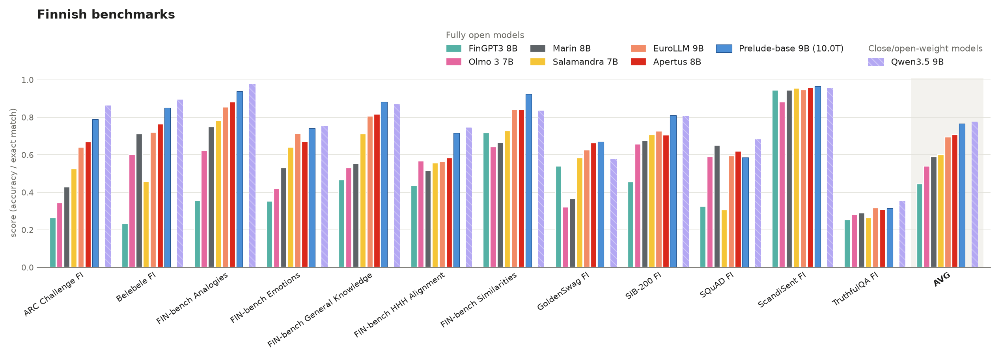

# Prelude evaluations

Compares OpenEuroLLM Prelude 9B with fully open models (open weights and
training data) and open-weight models of similar size on English,
Multilingual, German, Norwegian and Finnish benchmarks; run it with
`uv run plot_results.py`. 

The script downloads the scores from the HF datasets
`openeurollm/prelude-base-eval-scores` and `ellamind/eval-scores-ref`, takes
each model's released model (else its latest checkpoint), keeps only the tasks
every model of a category has, and averages tasks within each benchmark group
and then over groups (AVG, which excludes BLEU/chrF translation scores). 

## Update model card

The Evaluation section of the
[prelude-base model card](https://huggingface.co/openeurollm/prelude-base) is
`model_card_evaluation.md`; edit it there, regenerate the figures with
`uv run plot_results.py`, then run

```bash
uv run update_model_card_evaluation_section.py                  # show the diff only
uv run update_model_card_evaluation_section.py --commit-change  # push it
```

The script replaces the model card's Evaluation section (up to the next heading
of the same level) with the markdown file and always prints the diff. With
`--commit-change` it uploads the new README.md and the referenced figures to the
model repo in one commit, which needs an HF token with write access
(`hf auth login`).

# Results

Automatically generated by `plot_results.py` on 2026-11-12; do not edit below this line.

## English (decontaminated only)


| model | GPQA | Gen | MMLU Humanities MC | MMLU Other MC | MMLU STEM MC | MMLU Social Sciences MC | Math | Minerva Math Gen | Non-STEM QA MC | STEM QA MC | AVG |
|---|---:|---:|---:|---:|---:|---:|---:|---:|---:|---:|---:|
| ***Fully open models*** | | | | | | | | | | | |
| EuroLLM 9B 2512 (4.0T) | 0.29 | 0.72 | 0.62 | 0.61 | 0.48 | 0.64 | 0.07 | 0.12 | 0.73 | 0.77 | 0.50 |
| Apertus 8B (15.0T) | 0.29 | 0.76 | 0.69 | 0.68 | 0.54 | 0.74 | 0.31 | 0.13 | 0.78 | 0.85 | 0.58 |
| Marin 8B | 0.27 | **0.79** | 0.71 | 0.71 | 0.59 | 0.77 | 0.44 | 0.24 | 0.81 | 0.86 | 0.62 |
| Olmo 3 7B (6.1T) | 0.28 | 0.73 | 0.69 | 0.69 | 0.60 | 0.75 | 0.58 | 0.39 | 0.78 | 0.86 | 0.63 |
| Prelude-base 9B (10.0T) | 0.33 | 0.77 | 0.75 | 0.73 | 0.66 | 0.80 | 0.63 | 0.43 | 0.82 | 0.90 | 0.68 |
| ***Close/open-weight models*** | | | | | | | | | | | |
| Llama 3.1 8B (15.0T) | 0.30 | 0.78 | 0.70 | 0.70 | 0.58 | 0.75 | 0.39 | 0.19 | 0.78 | 0.83 | 0.60 |
| Qwen3.5 9B | **0.42** | 0.77 | **0.82** | **0.82** | **0.78** | **0.87** | **0.68** | **0.49** | **0.87** | **0.93** | **0.75** |

## Multilingual (decontaminated only)


| model | ARC Challenge MT | Belebele | Global MMLU | INCLUDE | MultiBLiMP | XCSQA | xHellaSwag | AVG |
|---|---:|---:|---:|---:|---:|---:|---:|---:|
| ***Fully open models*** | | | | | | | | |
| Olmo 3 7B | 0.30 | 0.66 | 0.46 | 0.37 | 0.78 | 0.34 | 0.41 | 0.47 |
| Marin 8B | 0.31 | 0.70 | 0.49 | 0.40 | 0.82 | 0.33 | 0.47 | 0.50 |
| EuroLLM 9B | 0.41 | 0.74 | 0.53 | 0.50 | 0.92 | 0.36 | 0.62 | 0.58 |
| Apertus 8B (15.0T) | 0.46 | 0.79 | 0.59 | 0.59 | **0.94** | 0.42 | 0.64 | 0.63 |
| Prelude-base 9B (10.0T) | **0.48** | 0.87 | 0.66 | 0.62 | **0.94** | **0.44** | **0.65** | **0.67** |
| ***Close/open-weight models*** | | | | | | | | |
| Llama 3.1 8B | 0.39 | 0.78 | 0.55 | 0.52 | 0.90 | 0.43 | 0.56 | 0.59 |
| Qwen3.5 9B | 0.46 | **0.91** | **0.71** | **0.68** | 0.89 | 0.40 | 0.62 | **0.67** |

## German


| model | AGIEval MC | AGIEval Sat En Without Passage MC | CoQA Gen | GLP | GLP MC | Gen | Held-out | INCLUDE MC | MMLU Pro MC | MMMLU Non-STEM MC | MMMLU STEM MC | MMMLU Social Sciences MC | Minerva Math Gen | Non-STEM QA MC | STEM QA MC | AVG |
|---|---:|---:|---:|---:|---:|---:|---:|---:|---:|---:|---:|---:|---:|---:|---:|---:|
| ***Fully open models*** | | | | | | | | | | | | | | | | |
| Olmo 3 7B (6.1T) | 0.42 | 0.36 | 0.33 | 0.89 | 0.64 | 0.53 | 0.29 | 0.51 | 0.28 | 0.48 | 0.46 | 0.48 | 0.20 | 0.79 | 0.67 | 0.49 |
| EuroLLM 9B 2512 (4.0T) | 0.40 | 0.38 | 0.32 | **0.96** | 0.69 | 0.76 | 0.27 | 0.49 | 0.26 | 0.52 | 0.45 | 0.46 | 0.09 | 0.91 | 0.81 | 0.52 |
| Marin 8B | 0.46 | 0.42 | 0.38 | 0.91 | 0.66 | 0.62 | 0.27 | 0.49 | 0.29 | 0.51 | 0.48 | 0.50 | 0.12 | 0.89 | 0.78 | 0.52 |
| Apertus 8B (15.0T) | 0.46 | 0.42 | **0.44** | **0.96** | 0.74 | 0.80 | 0.27 | 0.56 | 0.32 | 0.59 | 0.50 | 0.57 | 0.08 | 0.94 | 0.87 | 0.57 |
| Prelude-base 9B (10.0T) | 0.57 | 0.48 | 0.36 | **0.96** | 0.79 | **0.81** | 0.30 | 0.59 | 0.41 | 0.64 | 0.62 | 0.67 | 0.21 | 0.96 | 0.93 | 0.62 |
| ***Close/open-weight models*** | | | | | | | | | | | | | | | | |
| Llama 3.1 8B (15.0T) | 0.45 | 0.42 | 0.41 | 0.95 | 0.68 | 0.73 | 0.26 | 0.49 | 0.31 | 0.55 | 0.48 | 0.54 | 0.10 | 0.91 | 0.80 | 0.54 |
| Qwen3.5 9B | **0.67** | **0.53** | 0.22 | **0.96** | **0.87** | 0.80 | **0.38** | **0.68** | **0.51** | **0.72** | **0.72** | **0.79** | **0.35** | **0.98** | **0.96** | **0.68** |

## Norwegian


| model | ASK GEC | MultiBLiMP SME | NCB | NRK Quiz QA NB | NRK Quiz QA NN | NoCoLA | NoReC Document | NoReC Sentence | NorBelebele | NorCommonsenseQA NB | NorCommonsenseQA NN | NorIdiom NB | NorIdiom NN | NorOpenBookQA NB | NorOpenBookQA NN | NorOpenBookQA no-fact NB | NorOpenBookQA no-fact NN | NorQuAD | NorTruthfulQA MC NB | NorTruthfulQA MC NN | SLIDE | NorSumm NB→NN | NorSumm NN→NB | Tatoeba EN→NB | Tatoeba EN→NN | Tatoeba NB→EN | Tatoeba NB→SME | Tatoeba NN→EN | Tatoeba SME→NB | AVG |
|---|---:|---:|---:|---:|---:|---:|---:|---:|---:|---:|---:|---:|---:|---:|---:|---:|---:|---:|---:|---:|---:|---:|---:|---:|---:|---:|---:|---:|---:|---:|
| ***Fully open models*** | | | | | | | | | | | | | | | | | | | | | | | | | | | | | | |
| Olmo 3 7B | 0.21 | 0.64 | 0.71 | 0.41 | 0.37 | 0.72 | 0.62 | 0.48 | 0.58 | 0.39 | 0.25 | 0.05 | 0.06 | 0.61 | 0.47 | 0.39 | 0.33 | 0.48 | 0.46 | 0.53 | 0.36 | 41.5 | 46.8 | 29.0 | 10.3 | 49.2 | 0.5 | 38.5 | 1.2 | 0.43 |
| EuroLLM 9B 2512 | **0.47** | 0.67 | 0.79 | 0.53 | 0.50 | 0.85 | 0.78 | 0.68 | 0.62 | 0.71 | 0.46 | 0.32 | 0.24 | 0.78 | 0.72 | 0.55 | 0.54 | 0.46 | 0.53 | 0.49 | 0.57 | 52.5 | 67.6 | **56.1** | 25.9 | **60.9** | 0.3 | 57.5 | 4.3 | 0.58 |
| Apertus 8B | 0.45 | **0.75** | 0.73 | 0.54 | 0.52 | 0.85 | 0.65 | 0.61 | 0.67 | 0.67 | 0.46 | **0.37** | 0.42 | 0.81 | 0.79 | 0.59 | 0.50 | **0.65** | 0.50 | 0.49 | 0.49 | 66.5 | 72.5 | 54.3 | 43.3 | 59.6 | **2.0** | 57.7 | 13.3 | 0.60 |
| Prelude-base 9B (10.0T) | **0.47** | 0.68 | **0.81** | 0.55 | **0.56** | **0.86** | 0.71 | **0.81** | 0.75 | 0.69 | 0.58 | 0.35 | **0.56** | 0.86 | 0.81 | 0.71 | 0.67 | 0.53 | 0.57 | 0.67 | 0.56 | **67.8** | **76.2** | 55.6 | **46.2** | 58.2 | 0.4 | **59.4** | 3.0 | 0.65 |
| ***Close/open-weight models*** | | | | | | | | | | | | | | | | | | | | | | | | | | | | | | |
| Llama 3.1 8B | 0.16 | 0.67 | 0.76 | 0.47 | 0.47 | 0.81 | 0.76 | 0.63 | 0.60 | 0.49 | 0.36 | 0.15 | 0.19 | 0.67 | 0.62 | 0.43 | 0.40 | 0.61 | 0.57 | 0.54 | 0.57 | 56.2 | 61.7 | 44.8 | 31.4 | 57.9 | 0.3 | 54.6 | 2.1 | 0.52 |
| Qwen3.5 9B | 0.36 | 0.69 | 0.78 | **0.56** | 0.53 | 0.80 | **0.90** | 0.61 | **0.86** | **0.75** | **0.60** | 0.24 | 0.24 | **0.89** | **0.87** | **0.81** | **0.76** | 0.51 | **0.59** | **0.81** | **0.64** | 63.6 | 71.3 | 50.7 | 35.5 | 60.2 | 0.7 | 56.5 | **14.6** | **0.66** |

## Finnish



| model | ARC Challenge FI | Belebele FI | FIN-bench Analogies | FIN-bench Emotions | FIN-bench General Knowledge | FIN-bench HHH Alignment | FIN-bench Similarities | GoldenSwag FI | SIB-200 FI | SQuAD FI | ScandiSent FI | TruthfulQA FI | AVG |
|---|---:|---:|---:|---:|---:|---:|---:|---:|---:|---:|---:|---:|---:|
| ***Fully open models*** | | | | | | | | | | | | | |
| FinGPT3 8B | 0.27 | 0.23 | 0.36 | 0.35 | 0.47 | 0.44 | 0.72 | 0.54 | 0.46 | 0.33 | 0.95 | 0.25 | 0.45 |
| Olmo 3 7B | 0.35 | 0.60 | 0.62 | 0.42 | 0.53 | 0.57 | 0.64 | 0.32 | 0.66 | 0.59 | 0.88 | 0.28 | 0.54 |
| Marin 8B | 0.43 | 0.71 | 0.75 | 0.53 | 0.55 | 0.52 | 0.67 | 0.37 | 0.68 | 0.65 | 0.94 | 0.29 | 0.59 |
| Salamandra 7B | 0.52 | 0.46 | 0.78 | 0.64 | 0.71 | 0.56 | 0.73 | 0.58 | 0.71 | 0.31 | 0.96 | 0.26 | 0.60 |
| EuroLLM 9B | 0.64 | 0.72 | 0.86 | 0.71 | 0.81 | 0.56 | 0.84 | 0.63 | 0.73 | 0.60 | 0.95 | 0.32 | 0.70 |
| Apertus 8B | 0.67 | 0.76 | 0.88 | 0.67 | 0.82 | 0.58 | 0.84 | **0.67** | 0.71 | 0.62 | 0.96 | 0.31 | 0.71 |
| Prelude-base 9B (10.0T) | 0.79 | 0.85 | 0.94 | 0.74 | **0.88** | 0.72 | **0.92** | **0.67** | **0.81** | 0.59 | **0.97** | 0.31 | 0.77 |
| ***Close/open-weight models*** | | | | | | | | | | | | | |
| Qwen3.5 9B | **0.86** | **0.89** | **0.98** | **0.75** | 0.87 | **0.74** | 0.84 | 0.58 | **0.81** | **0.68** | 0.96 | **0.35** | **0.78** |
