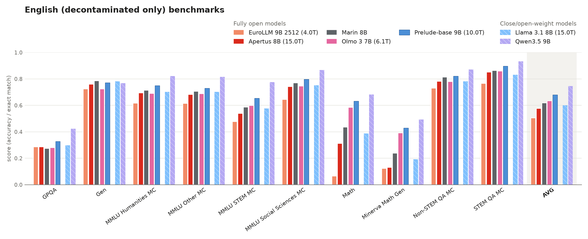
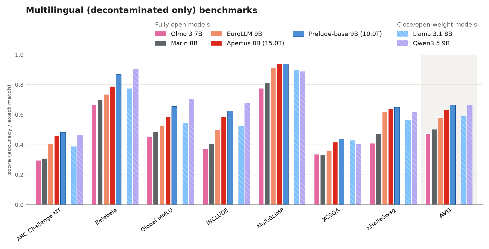
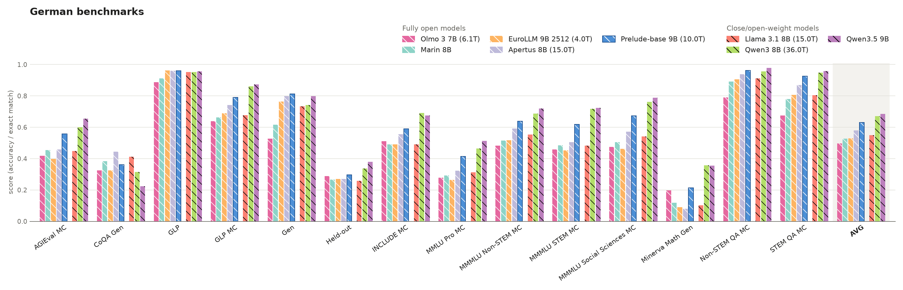
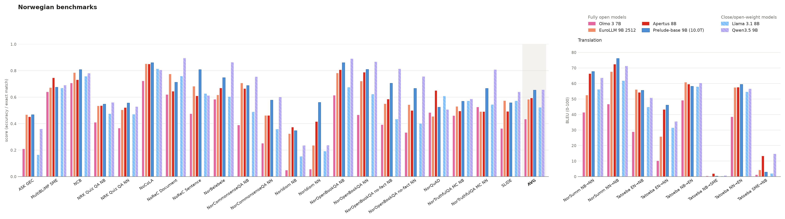

## Evaluation

We report evaluations in this model card on English and Multilingual benchmarks together with in-depth benchmarks developed for German, Norwegian and Finnish as part of the consortium.

**English & Multilingual evaluations.**
We show here the performance on English & Multilingual evaluations.

Those tasks were all decontaminated from our training data, we do not know whether they are part of the training set of other methods.

**In-depth evaluations.**
We show the performance in German, Norwegian (NorEval) and Finnish. 
Those tasks were not explicitly decontaminated but we do not expect large contamination.

Finnish: TODO.

**Other evaluations and details.** 
Evaluations including on tasks which were not explicitly decontaminated are available [here](https://github.com/OpenEuroLLM/notebooks/tree/main/prelude-evaluations-model-card).
This directory also generates all figures given evaluation stored on this [HuggingFace repository](https://huggingface.co/datasets/openeurollm/prelude-base-eval-scores/tree/main).
